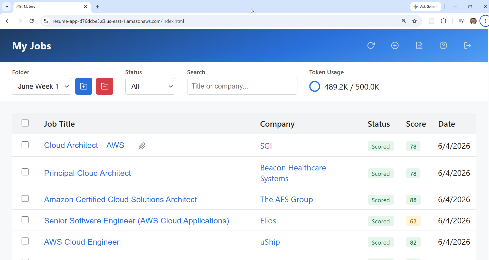

# Resume Scorer on AWS: Cognito, API Gateway, SQS, Lambda and Bedrock

A serverless **resume scoring** app. Users sign in with **Cognito**, store
one or more resumes, and submit job postings as a URL, pasted text, or
LinkedIn job IDs. An **API Gateway HTTP API** with a JWT authorizer queues
each job on **SQS**, and a worker **Lambda** fetches the posting, has
**Claude Haiku on Amazon Bedrock** extract the job details and score the
resume from 0 to 100, and writes an analysis split into strengths and
weaknesses. Data lives in **DynamoDB** and a private **S3** bucket, and a
vanilla JavaScript single-page app on S3 ties it together.



| Piece | Where | Role |
|---|---|---|
| **resume-app-user-pool-&lt;hex&gt;** | Cognito | email sign-in; Hosted UI on `resume-app-auth-<hex>`; SPA client using the authorization code flow |
| **resume-api-&lt;hex&gt;** | API Gateway, us-east-1 | HTTP API; every route behind a Cognito JWT authorizer; CORS limited to the site's origin |
| **resume-api-&lt;hex&gt;** | Lambda | one Python 3.11 function, 10 s, serving every route (`handler.py` dispatches to `resumes.py`, `jobs.py`, `folders.py`, `attachments.py`, `users.py`) |
| **job-requests** | SQS | 30 min visibility timeout, 4 day retention, 20 s long polling; sends a message to `job-requests-dlq` (14 day retention) after one failed receive |
| **resume-worker-&lt;hex&gt;** | Lambda | Python 3.11 with BeautifulSoup, 512 MB, 300 s; triggered one message at a time |
| **resume-app-&lt;hex&gt;** | DynamoDB | single table keyed on `pk` / `sk`: users, usage counters, resumes, jobs, folders, attachments |
| **resume-data-&lt;hex&gt;** | S3 | private, AES-256 encrypted; resume text, job descriptions, resume snapshots, analyses and attachments |
| **resume-app-&lt;hex&gt;** | S3 | public static website with the SPA |

## Architecture

<picture>
  <source media="(prefers-color-scheme: dark)" srcset="architecture-dark.svg">
  
</picture>

Regenerate with `python3 make_diagram.py`.

- **`01-core/`**: everything except the site's files: Cognito, the API and
  its routes, both functions (one shared role and code zip in `code/`),
  the queues, the table and both buckets.
- **`02-webapp/`**: the SPA (`index.html`, `job.html`, `callback.html`,
  `js/`, `css/`); `apply.sh` renders `js/config.js` from its template.
- **`bedrock-config.sh`**: the Bedrock model ID, sourced by `apply.sh`,
  `destroy.sh` and `check_env.sh`.

## How a job is scored

1. On first sign-in the page calls `POST /register`, which creates the
   user's usage record, up to a cap of 100 users.
2. `POST /jobs` checks the user is under their token limit, saves a
   snapshot of the chosen resume, writes the job as `submitted`, and sends
   it to the queue. LinkedIn job IDs become one job each, using the
   `linkedin.com/jobs/view/<id>` URL.
3. The worker fetches the URL (or reads the pasted text), strips the page to
   its visible text, and needs at least 100 characters. It calls Bedrock
   once to extract the title, company and other fields, then again to score
   the resume against the job.
4. It stores the job description and the analysis in S3 and the score and
   fields in DynamoDB, marks the job `Scored` (or `Error` with a message if
   the fetch, extraction or scoring fails), and adds both calls' input and output tokens to the
   user's `tokens_used` with an atomic `ADD`.

The default limit is 100,000 tokens per user for the account's lifetime;
`POST /jobs` returns `429` once it's used. To reset or raise it, edit
`tokens_used` or `token_limit` on the user's `USER#<id>` / `USER#USAGE` item
in DynamoDB.

## API

Every route needs `Authorization: Bearer <Cognito token>`; everything is
scoped to the token's user through the `USER#<id>` partition key.

| Area | Routes |
|---|---|
| Resumes | `POST /resumes`, `GET /resumes`, `GET`/`PUT`/`DELETE /resumes/{resume_id}` |
| Jobs | `POST /jobs` (URL, raw text or LinkedIn IDs), `GET /jobs`, `GET`/`DELETE /jobs/{job_id}`, `PATCH /jobs/{job_id}/notes`, `PATCH /jobs/{job_id}/folder` |
| Attachments | `GET`/`POST /jobs/{job_id}/attachments`, `GET`/`DELETE /jobs/{job_id}/attachments/{att_id}`; base64 JSON, up to 10 MB each and 5 per job |
| Folders | `POST /folders`, `GET /folders`, `DELETE /folders/{folder_id}` (its jobs become unassigned) |
| Account | `POST /register`, `GET /usage` (`tokens_used` and `token_limit`) |

Deleting a job also deletes its S3 objects.

## Changing the Bedrock model

Edit the export in `bedrock-config.sh`:

```bash
export BEDROCK_MODEL_ID="us.anthropic.claude-haiku-4-5-20251001-v1:0"
```

`check_env.sh` checks the inference profile is available, and `apply.sh`
passes it to the worker as `BEDROCK_MODEL_ID`. A model with a different
request format also needs the prompt payloads in `01-core/code/worker.py`
changed.

## Prerequisites

* [An AWS Account](https://aws.amazon.com/console/) with access to the
  Bedrock model above
* [Install AWS CLI](https://docs.aws.amazon.com/cli/latest/userguide/getting-started-install.html)
* [Install Terraform](https://developer.hashicorp.com/terraform/install)
* [Install jq](https://jqlang.github.io/jq/download/), `pip` and `envsubst`

If this is your first time following along, we recommend starting with this
video: [AWS + Terraform: Easy Setup](https://www.youtube.com/watch?v=9clW3VQLyxA).

## Deploy

```bash
git clone https://github.com/mamonaco1973/aws-resume-app.git
cd aws-resume-app
./apply.sh
```

Everything deploys to `us-east-1`. `apply.sh` installs the worker's
dependencies into `01-core/code` with `pip`, applies `01-core`, renders
`02-webapp/js/config.js` with the API URL and Cognito settings, and copies
`02-webapp` to the site bucket. It ends by running `validate.sh`, which
prints the URL:

```
=================================================================================
  Resume Scorer — Deployment validated!
=================================================================================
  App : https://resume-app-<hex>.s3.us-east-1.amazonaws.com/index.html
=================================================================================
```

## Try it

1. Open the **App** URL and sign in; on first use choose **Sign up** in the
   Hosted UI and confirm your email with the code Cognito sends.
2. Open **Manage Resumes**, create a resume, and paste in its plain text.
3. Choose **Score New Job**, pick the resume and optionally a folder, and
   give the job as a URL, pasted description, or LinkedIn job IDs (one per
   line). The dashboard refreshes every 5 seconds while jobs are pending;
   scoring usually takes 15 to 90 seconds.
4. Once a job shows **Scored**, open it to read the score, the strengths and
   weaknesses, and the extracted job details. Add notes, move it to a
   folder, or attach files such as a tailored resume or cover letter.

Some sites block automated fetches or need a login; paste the description
instead.

## Teardown

```bash
./destroy.sh
```

## Notes

- **Lab only.** Anyone can sign up, up to the 100-user cap. The worker's
  Bedrock permission is `bedrock:InvokeModel` on `*`.
- Failures aren't retried: the worker records `Error` and returns
  normally, and a run that times out or crashes goes straight to the
  dead-letter queue after one receive.
- `.claude/settings.local.json` is committed; it's a local Claude Code
  permissions file, not part of the app.
